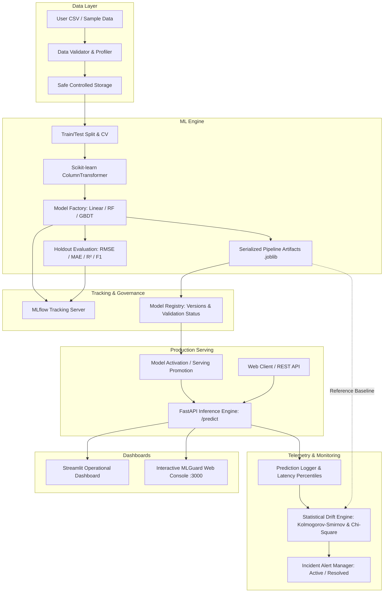

# MLGuard: Automated Machine Learning Training, Deployment & Monitoring Platform

[](https://github.com/mlguard/mlguard/actions)
[](https://www.python.org/)
[](https://fastapi.tiangolo.com)
[](https://scikit-learn.org/)
[](https://mlflow.org/)
[](https://www.docker.com/)

---

## 1. Project Overview & Problem Statement

Production machine learning systems fail in ways traditional software does not. While software code is static, data is dynamic: input feature distributions shift, consumer preferences evolve, and latency degrades under burst load. Most data science prototypes remain confined to Jupyter Notebooks because moving from a local script to an automated, auditable serving pipeline with statistical guardrails is notoriously complex.

**MLGuard** bridges this gap. It is an end-to-end, production-style tabular machine learning platform that automates:
1. **Schema Validation & Ingestion**: Detecting missing values, constant features, high-cardinality ID columns, and target leakage risks.
2. **Leakage-Free Preprocessing**: Fitting imputation and categorical one-hot transformers strictly on training splits.
3. **Multi-Model Training**: Training and cross-validating Linear Models, Random Forests, and Gradient Boosting estimators.
4. **Experiment Tracking**: Persisting parameters, evaluation metrics, and artifacts via MLflow.
5. **Immutable Model Registry**: Auditable version control with one-click promotion and automated demotion.
6. **Low-Latency Inference**: FastAPI serving endpoints returning sub-20ms predictions and class probability distributions.
7. **Continuous Drift Monitoring**: Real-time two-sample Kolmogorov-Smirnov (KS) and Chi-Square hypothesis testing comparing live traffic against baseline training distributions.

---

## 2. System Architecture



---

## 3. Tech Stack

- **Backend Serving**: Python 3.11, FastAPI, Uvicorn, Pydantic v2
- **ML Pipeline**: Scikit-Learn 1.4+, NumPy, Pandas, SciPy (stats)
- **Experiment Tracking**: MLflow
- **Metadata Database**: SQLite + SQLAlchemy ORM
- **Frontend Dashboards**: Streamlit, Plotly, Vite + React + Tailwind CSS
- **Testing & Quality**: Pytest, Pytest-Cov, HTTPX, Ruff
- **Infrastructure**: Docker, Docker Compose, GitHub Actions CI

---

## 4. Repository Structure

```
mlguard/
├── app/
│   ├── api/
│   │   ├── main.py                  # FastAPI app entry point & CORS
│   │   ├── dependencies.py          # Service dependency injection
│   │   └── routes/
│   │       ├── health.py            # /health & /ready probes
│   │       ├── datasets.py          # /datasets upload & schema inspect
│   │       ├── training.py          # /training/jobs execution & status
│   │       ├── experiments.py       # /experiments queries
│   │       ├── models.py            # /models registry & activation
│   │       ├── predictions.py       # /predict inference endpoint
│   │       └── monitoring.py        # /monitoring/drift, summary, alerts
│   ├── core/
│   │   ├── config.py                # Pydantic Settings
│   │   ├── logging_config.py        # JSON structured logging
│   │   └── exceptions.py            # Domain exceptions
│   ├── schemas/                     # Typed request/response models
│   ├── services/                    # Business logic services
│   ├── ml/
│   │   ├── data_validation.py       # Data integrity & leakage checks
│   │   ├── preprocessing.py         # ColumnTransformer builder
│   │   ├── model_factory.py         # Estimators factory
│   │   ├── evaluation.py            # Holdout metrics & best model picker
│   │   ├── training.py              # Training pipeline orchestrator
│   │   └── drift_detection.py       # KS & Chi-square statistical tests
│   ├── db/                          # SQLAlchemy database engine & tables
│   ├── dashboard/                   # Multi-page Streamlit dashboard
│   └── utils/                       # Hashing & safe file utilities
├── data/
│   └── sample/                      # Sample housing & churn CSVs
├── scripts/
│   ├── generate_sample_data.py      # Synthetic offline data generator
│   └── seed_demo.py                 # Full 1-click end-to-end demo runner
├── tests/
│   ├── unit/                        # Unit tests for validation, ML & drift
│   ├── api/                         # FastAPI TestClient endpoint tests
│   └── integration/                 # E2E pipeline integration tests
├── .github/workflows/ci.yml         # GitHub Actions CI matrix
├── Dockerfile                       # Multi-stage production container
├── docker-compose.yml               # Local multi-service orchestration
├── requirements.txt                 # Pinned dependencies
├── pyproject.toml                   # Project metadata & Ruff config
├── Makefile                         # Developer commands
└── README.md
```

---

## 5. Local Setup & Quickstart

### Prerequisites
- Python 3.10 or 3.11
- pip, virtualenv

### 1. Installation
```bash
# Clone the repository
git clone https://github.com/mlguard/mlguard.git
cd mlguard

# Create and activate virtual environment
python3 -m venv venv
source venv/bin/activate  # On Windows: venv\Scripts\activate

# Install dependencies
pip install -r requirements.txt
```

### 2. Generate Demo Data & Seed Workflows
Run the offline seeding script to create sample datasets, train models, log to MLflow, and simulate production traffic:
```bash
python scripts/seed_demo.py
```

### 3. Start Backend API
```bash
uvicorn app.api.main:app --host 0.0.0.0 --port 8000 --reload
```
Interactive API documentation will be available at: **`http://localhost:8000/docs`**

### 4. Start Streamlit Dashboard
In a new terminal window:
```bash
streamlit run app/dashboard/Home.py --server.port 8501
```
Dashboard available at: **`http://localhost:8501`**

---

## 6. Docker & Docker Compose Setup

Run the entire platform (FastAPI, Streamlit, and MLflow) with a single command:
```bash
docker-compose up --build -d
```
Service URLs:
- **FastAPI Documentation**: `http://localhost:8000/docs`
- **Streamlit Dashboard**: `http://localhost:8501`
- **MLflow Tracking UI**: `http://localhost:5000`

To tear down services:
```bash
docker-compose down
```

---

## 7. API Endpoint Reference

### Health & Readiness
- `GET /health` → Returns `{"status": "healthy", "service": "MLGuard"}`
- `GET /ready` → Verifies database connection and disk storage mounts.

### Dataset Ingestion
- `POST /api/v1/datasets/upload` (multipart/form-data)
  - Validates row/col counts, duplicate rows, missingness, and leakage.
- `GET /api/v1/datasets` → Lists registered datasets.
- `GET /api/v1/datasets/{dataset_id}` → Returns complete column profiling summary.

### Training Jobs
- `POST /api/v1/training/jobs`
  ```json
  {
    "dataset_id": "ds_housing_prices",
    "target_column": "sale_price",
    "task_type": "regression",
    "models": ["gradient_boosting", "random_forest", "linear_regression"],
    "test_size": 0.2,
    "cv_folds": 3,
    "random_state": 42
  }
  ```
- `GET /api/v1/training/jobs/{job_id}` → Returns training status and holdout scores.

### Model Registry & Serving
- `GET /api/v1/models` → Lists model versions, metrics, and validation flags.
- `GET /api/v1/models/active` → Returns currently deployed serving model.
- `POST /api/v1/models/{model_id}/activate` → Promotes candidate model to production.

### Real-Time Inference
- `POST /api/v1/predict`
  ```json
  {
    "features": [
      {
        "square_feet": 2400,
        "bedrooms": 3,
        "bathrooms": 2.5,
        "year_built": 2005,
        "neighborhood": "Downtown",
        "property_type": "Single Family",
        "garage_spaces": 2
      }
    ]
  }
  ```
  **Response:**
  ```json
  {
    "request_id": "req_8fa19b02",
    "model_id": "mod_gradient_boosting_run_1a",
    "model_version": 1,
    "task_type": "regression",
    "predictions": [{"prediction": 535000.0, "probabilities": null}],
    "latency_ms": 11.4,
    "timestamp": "2026-10-12T03:30:00Z"
  }
  ```

### Monitoring & Drift Detection
- `GET /api/v1/monitoring/summary` → Returns total requests, avg latency, p50, p95, p99 latency.
- `GET /api/v1/monitoring/drift` → Runs Kolmogorov-Smirnov test and reports p-values.
- `GET /api/v1/monitoring/alerts` → Returns active and resolved drift/latency alerts.
- `POST /api/v1/monitoring/alerts/{alert_id}/status?new_status=RESOLVED` → Resolves alert.

---

## 8. Monitoring & Statistical Drift Methodology

### Numerical Features: Two-Sample Kolmogorov-Smirnov Test
For each continuous numerical feature $X$, MLGuard compares the empirical cumulative distribution function (ECDF) of the baseline training set $F_{ref}(x)$ against the ECDF of recent production inference traffic $F_{prod}(x)$:

$$D = \sup_{x} |F_{ref}(x) - F_{prod}(x)|$$

The null hypothesis $H_0$ states that both samples are drawn from the same continuous distribution. If the computed $p$-value falls below the configured threshold ($\alpha = 0.05$), the null hypothesis is rejected, and a `DATA_DRIFT` alert is triggered.

**Documented Limitation:** With very large sample sizes ($N > 100,000$), the KS test becomes sensitive to infinitesimal distribution shifts that carry negligible practical business impact. MLGuard handles this with a sliding evaluation window of recent requests.

### Categorical Features: Chi-Square Goodness-of-Fit & Total Variation Distance
For categorical features with expected counts $\ge 5$, MLGuard evaluates the Chi-Square statistic:

$$\chi^2 = \sum \frac{(O_i - E_i)^2}{E_i}$$

When sample sizes are small or zero cells exist, the system falls back to Total Variation Distance ($TVD = \frac{1}{2} \sum |p_i - q_i|$).

### Important Note: Data Drift vs. Model Performance Degradation
Data drift indicates that the input feature distribution has shifted ($P(X_{prod}) \neq P(X_{train})$). **Drift does not necessarily mean prediction error has increased.** Prediction accuracy can only be confirmed once actual ground-truth labels are observed. MLGuard provides a delayed ground-truth endpoint (`/monitoring/ground-truth`) to separate input drift from realized degradation.

---

## 9. Automated Testing & Verification

Run the test suite with coverage:
```bash
pytest tests/ -v --cov=app
```

### Verified Test Suite
- `tests/unit/test_validation.py`: Verifies row/col limits, duplicate detection, ID column detection, and target type validations.
- `tests/unit/test_preprocessing.py`: Verifies `ColumnTransformer` isolation, median imputation, and unseen category safety.
- `tests/unit/test_training.py`: Tests regression and classification pipeline fitting and artifact serialization.
- `tests/unit/test_evaluation.py`: Verifies MAE, RMSE, R², Accuracy, Precision, Recall, F1, and ROC-AUC calculations.
- `tests/unit/test_drift.py`: Verifies KS two-sample test on identical vs. shifted distributions.
- `tests/api/test_api_endpoints.py`: Integration tests for `/health`, `/ready`, `/datasets/upload`, and `/predict`.
- `tests/integration/test_pipeline_e2e.py`: Complete lifecycle test (Upload → Train → Register → Predict → Telemetry).

---

## 10. Fresher & Interview Architecture Explanation

### 30-Second Interview Pitch:
> "MLGuard is a production-style MLOps platform built with FastAPI, Scikit-learn, and Streamlit. It solves the issue of silent model degradation in production. The system validates uploaded CSV schemas to prevent target leakage, trains multiple algorithms using scikit-learn pipelines with strict train/test separation, logs experiment metrics and artifacts to MLflow, and stores versioned models in an immutable registry. Deployed models serve real-time predictions with sub-20ms latency while our monitoring engine continuously runs two-sample Kolmogorov-Smirnov hypothesis tests against training baselines to trigger alerts the moment data drift occurs."

### Core Architectural Concepts:
1. **Data Leakage Prevention**: Transformers (scalers, imputers, encoders) are fit strictly on training folds ($X_{train}$) and only transform test folds ($X_{test}$) and production inference records.
2. **Immutable Model Registry**: We never overwrite existing model binaries. We assign semantic versions (v1, v2) and update a database pointer to switch the active serving target.
3. **Graceful Degraded Mode**: If MLflow or the database experiences downtime, the inference engine continues serving predictions using cached local pipeline artifacts.
