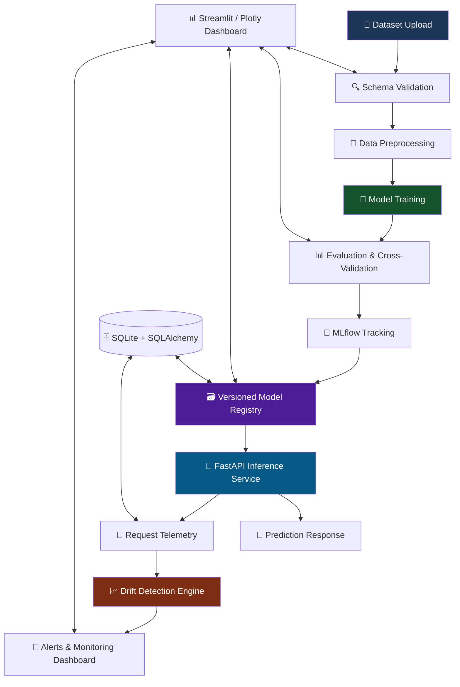
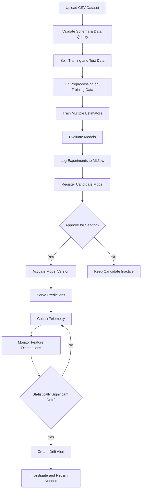
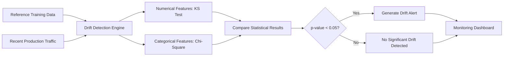
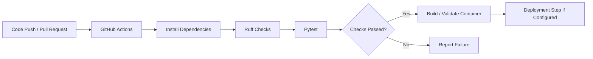

# 🛡️ MLGuard — Automated Machine Learning Training, Deployment & Monitoring Platform

**Production-style MLOps | CI/CD | Model Registry | Real-Time Inference | Statistical Drift Detection**

<p align="center">
  <a href="https://ais-dev-2fl5gz6vapwjjqugqgj5mu-941486271451.asia-east1.run.app/"><strong>🚀 Live Demo</strong></a>
  &nbsp; • &nbsp;
  <a href="./arch.pdf"><strong>🏗️ Architecture PDF</strong></a>
  &nbsp; • &nbsp;
  <a href="#-api-endpoint-reference"><strong>📖 API Reference</strong></a>
</p>

---

## 📌 1. Project Overview

Production machine learning systems face challenges that traditional software systems do not. While application code may remain unchanged, incoming data distributions evolve, user behavior changes, and inference latency can degrade under load.

MLGuard addresses these challenges by providing an end-to-end platform for building, deploying, versioning, serving, and monitoring tabular machine learning models.

The platform integrates data validation, leakage-safe preprocessing, multi-model training, experiment tracking, model registry management, low-latency inference, and statistical drift detection.

### 🎯 Core Capabilities

- **Schema Validation & Ingestion:** Detect missing values, duplicate rows, constant features, ID-like columns, and potential target leakage.
- **Leakage-Safe Preprocessing:** Fit preprocessing transformations on training data only.
- **Multi-Model Training:** Train and compare linear models, Random Forests, and Gradient Boosting estimators.
- **Experiment Tracking:** Record parameters, evaluation metrics, and artifacts using MLflow.
- **Versioned Model Registry:** Track model versions and manage promotion to the active serving model.
- **Real-Time Inference:** Serve predictions through FastAPI endpoints.
- **Continuous Drift Monitoring:** Compare production traffic against reference training distributions using KS and Chi-square statistical tests.
- **Automated Quality Checks:** Run unit, API, and integration tests through Pytest and CI workflows.

## 🏗️ 2. System Architecture

**Full architecture document:** [View `arch.pdf`](./arch.pdf)

The following diagram illustrates the major components and their relationships.



### 🔄 End-to-End ML Lifecycle



### 📡 Monitoring and Drift Detection



*These diagrams represent the documented architecture and intended workflow. Actual deployment behavior depends on the implementation and configuration in the repository.*

## 🛠️ 3. Technology Stack

| Category | Technologies |
|---|---|
| Language | Python 3.11 |
| Backend API | FastAPI, Uvicorn, Pydantic v2 |
| Machine Learning | Scikit-learn 1.4+, NumPy, Pandas |
| Statistical Analysis | SciPy |
| Experiment Tracking | MLflow |
| Metadata Storage | SQLite, SQLAlchemy ORM |
| Dashboard | Streamlit, Plotly |
| Web UI | Vite, React, Tailwind CSS |
| Testing | Pytest, Pytest-Cov, HTTPX |
| Code Quality | Ruff |
| Containerization | Docker, Docker Compose |
| CI/CD | GitHub Actions |

## ✨ 4. Key Features

### 📂 Dataset Validation
- Validate uploaded tabular datasets.
- Detect missing values and duplicate records.
- Identify constant and high-cardinality ID-like columns.
- Flag potential target leakage risks.
- Generate dataset profiling information.

### ⚙️ Leakage-Safe Preprocessing
- Use Scikit-learn pipelines and `ColumnTransformer`.
- Apply numerical imputation and categorical encoding.
- Fit transformations on training data rather than the complete dataset.
- Handle unseen categories during inference when configured in the pipeline.

### 🤖 Multi-Model Training
- Train linear models, Random Forests, and Gradient Boosting estimators.
- Support regression and classification workflows.
- Evaluate candidate models using holdout data and cross-validation.
- Compare metrics before registering models.

### 🧪 Experiment Tracking
- Track model parameters and evaluation results.
- Store training artifacts through MLflow.
- Support experiment comparison and reproducibility.

### 🗃️ Model Registry
- Maintain identifiable model versions.
- Track model metrics and validation information.
- Promote candidate models to the active serving target.
- Preserve historical versions instead of overwriting registered artifacts.

### 🚀 Real-Time Inference
- Expose prediction functionality through FastAPI.
- Return prediction results, model metadata, request identifiers, and latency information where implemented.
- Support regression predictions and classification probabilities where applicable.

### 📈 Monitoring and Alerts
- Track request volume and latency percentiles.
- Compare recent input distributions with baseline data.
- Generate alerts for statistically significant feature drift.
- Provide alert status management and monitoring summaries.

## 📊 5. Dashboard and Metrics

The dashboard is designed to provide visibility into model training, registry status, prediction activity, and operational monitoring.

| Dashboard Area | Information |
|---|---|
| Dataset Explorer | Dataset structure, feature profiles, validation findings |
| Training | Training jobs, evaluation results, model comparisons |
| Experiments | MLflow experiment runs and artifacts |
| Model Registry | Model versions, metrics, active model |
| Predictions | Inference requests and response information |
| Monitoring | Latency percentiles, drift results, alerts |

### Example Monitoring Flow

```text
Prediction Request
       │
       ▼
 FastAPI Inference
       │
       ├──► Model Prediction
       │
       └──► Request Telemetry
                  │
                  ▼
          Statistical Checks
                  │
                  ▼
          Drift / Latency Alerts
                  │
                  ▼
          Monitoring Dashboard
```

Use actual application output when publishing numerical performance claims. For example, a reported latency value is meaningful only alongside the workload, hardware, and measurement conditions.

## 🗂️ 6. Repository Structure

```text
mlguard/
├── app/
│   ├── api/
│   │   ├── main.py
│   │   ├── dependencies.py
│   │   └── routes/
│   │       ├── health.py
│   │       ├── datasets.py
│   │       ├── training.py
│   │       ├── experiments.py
│   │       ├── models.py
│   │       ├── predictions.py
│   │       └── monitoring.py
│   ├── core/
│   │   ├── config.py
│   │   ├── logging_config.py
│   │   └── exceptions.py
│   ├── schemas/
│   ├── services/
│   ├── ml/
│   │   ├── data_validation.py
│   │   ├── preprocessing.py
│   │   ├── model_factory.py
│   │   ├── evaluation.py
│   │   ├── training.py
│   │   └── drift_detection.py
│   ├── db/
│   ├── dashboard/
│   └── utils/
├── data/
│   └── sample/
├── scripts/
│   ├── generate_sample_data.py
│   └── seed_demo.py
├── tests/
│   ├── unit/
│   ├── api/
│   └── integration/
├── .github/
│   └── workflows/
│       └── ci.yml
├── Dockerfile
├── docker-compose.yml
├── requirements.txt
├── pyproject.toml
├── Makefile
├── arch.pdf
└── README.md
```

*This tree reflects the documented project layout; verify that each listed file exists in the current repository.*

## 🚀 7. Local Setup & Quickstart

### Prerequisites

- Python 3.10 or 3.11
- Git
- pip and virtual environment support
- Docker and Docker Compose (optional)

### Step 1: Clone the Repository

Replace the example URL with your actual GitHub repository URL if it differs.

```bash
git clone https://github.com/udaykumar09072006/mlguard.git
cd mlguard
```

### Step 2: Create a Virtual Environment

**macOS / Linux**

```bash
python3 -m venv venv
source venv/bin/activate
```

**Windows**

```powershell
python -m venv venv
venv\Scripts\activate
```

### Step 3: Install Dependencies

```bash
python -m pip install --upgrade pip
pip install -r requirements.txt
```

### Step 4: Seed the Demo

If the repository includes the documented seeding script, run:

```bash
python scripts/seed_demo.py
```

This is intended to generate sample workflows, train models, record experiments, and simulate prediction activity.

### Step 5: Start the API

```bash
uvicorn app.api.main:app --host 0.0.0.0 --port 8000 --reload
```

Open the interactive API documentation:

- Swagger UI: `http://localhost:8000/docs`
- ReDoc: `http://localhost:8000/redoc`

### Step 6: Start the Dashboard

In a separate terminal with the virtual environment activated:

```bash
streamlit run app/dashboard/Home.py --server.port 8501
```

Dashboard: `http://localhost:8501`

*Run the commands from the repository root and adjust entry-point paths if the actual files differ.*

## 🐳 8. Docker & Docker Compose

If the repository contains the documented Docker configuration, build and start the services using:

```bash
docker compose up --build -d
```

Expected local service URLs, subject to the configured port mappings:

| Service | URL |
|---|---|
| FastAPI Swagger UI | `http://localhost:8000/docs` |
| Streamlit Dashboard | `http://localhost:8501` |
| MLflow Tracking UI | `http://localhost:5000` |

Stop the services:

```bash
docker compose down
```

## 🔌 9. API Endpoint Reference

The following endpoints reflect the documented API design. Confirm their exact paths against the running application or Swagger UI.

### Health and Readiness

| Method | Endpoint | Purpose |
|---|---|---|
| GET | `/health` | Check API health |
| GET | `/ready` | Check service readiness |

### Dataset Ingestion

| Method | Endpoint | Purpose |
|---|---|---|
| POST | `/api/v1/datasets/upload` | Upload and validate a dataset |
| GET | `/api/v1/datasets` | List registered datasets |
| GET | `/api/v1/datasets/{dataset_id}` | Retrieve dataset profiling information |

### Training and Experiments

| Method | Endpoint | Purpose |
|---|---|---|
| POST | `/api/v1/training/jobs` | Start a training job |
| GET | `/api/v1/training/jobs/{job_id}` | Retrieve job status and scores |
| GET | `/api/v1/experiments` | Query tracked experiments |

### Model Registry and Inference

| Method | Endpoint | Purpose |
|---|---|---|
| GET | `/api/v1/models` | List registered model versions |
| GET | `/api/v1/models/active` | Retrieve the active model |
| POST | `/api/v1/models/{model_id}/activate` | Activate a candidate model |
| POST | `/api/v1/predict` | Generate predictions |

### Monitoring

| Method | Endpoint | Purpose |
|---|---|---|
| GET | `/api/v1/monitoring/summary` | Retrieve request and latency statistics |
| GET | `/api/v1/monitoring/drift` | Inspect statistical drift results |
| GET | `/api/v1/monitoring/alerts` | List monitoring alerts |
| POST | `/api/v1/monitoring/alerts/{alert_id}/status` | Update alert status |

### Example Training Request

```json
{
  "dataset_id": "ds_housing_prices",
  "target_column": "sale_price",
  "task_type": "regression",
  "models": [
    "gradient_boosting",
    "random_forest",
    "linear_regression"
  ],
  "test_size": 0.2,
  "cv_folds": 3,
  "random_state": 42
}
```

### Example Prediction Request

```json
{
  "features": [
    {
      "square_feet": 2400,
      "bedrooms": 3,
      "bathrooms": 2.5,
      "year_built": 2005,
      "neighborhood": "Downtown",
      "property_type": "Single Family",
      "garage_spaces": 2
    }
  ]
}
```

### Example Prediction Response

```json
{
  "request_id": "req_example",
  "model_id": "mod_gradient_boosting_run_1a",
  "model_version": 1,
  "task_type": "regression",
  "predictions": [
    {
      "prediction": 535000.0,
      "probabilities": null
    }
  ],
  "latency_ms": 11.4,
  "timestamp": "2026-10-12T03:30:00Z"
}
```

*The JSON above illustrates the documented request/response format. The identifiers, prediction, and latency are examples, not guaranteed live results.*

## 📐 10. Statistical Drift Detection

MLGuard distinguishes changes in incoming feature distributions from actual degradation in model quality.

### Numerical Features — Two-Sample Kolmogorov–Smirnov Test

For a numerical feature, compare the empirical cumulative distribution functions of the reference and recent production samples:

\[
D = \sup_x \left|F_{\mathrm{ref}}(x)-F_{\mathrm{prod}}(x)\right|
\]

Where:

- \(F_{\mathrm{ref}}(x)\) represents the reference training distribution.
- \(F_{\mathrm{prod}}(x)\) represents the recent production distribution.
- \(D\) measures the maximum difference between the two empirical distributions.

The null hypothesis \(H_0\) states that both samples are drawn from the same continuous distribution.

With a configured significance threshold of \(\alpha=0.05\), a p-value below the threshold provides statistical evidence against the null hypothesis and may trigger a drift alert.

**Limitation:** With very large sample sizes, the test can flag small distribution differences that may not have practical business significance. Windowing, effect-size analysis, and domain-specific thresholds can help with interpretation.

### Categorical Features — Chi-Square Test

For categorical features with appropriate expected frequencies, the Chi-square statistic is:

\[
\chi^2 = \sum_i \frac{(O_i-E_i)^2}{E_i}
\]

Where:

- \(O_i\) is the observed category count.
- \(E_i\) is the expected category count under the reference distribution.

Small expected counts can invalidate standard approximations. Sparse or unseen categories need careful handling; alternative distance measures, such as Total Variation Distance, can supplement the analysis.

\[
\mathrm{TVD}(P,Q)=\frac{1}{2}\sum_i |p_i-q_i|
\]

### Data Drift vs. Model Performance Degradation

Data drift means the distribution of incoming features has changed:

\[
P(X_{\mathrm{prod}})\ne P(X_{\mathrm{train}})
\]

This does not automatically prove that model accuracy has decreased. Realized performance degradation requires ground-truth labels and appropriate evaluation metrics.

A delayed-label evaluation workflow can compare predictions with subsequently observed outcomes where the application supports it.

## 🧪 11. Automated Testing & Quality

Run the test suite with coverage:

```bash
pytest tests/ -v --cov=app
```

The documented test categories include:

| Test Area | Intended Coverage |
|---|---|
| Data Validation | Row/column limits, duplicate detection, ID-like columns |
| Preprocessing | Train/test isolation, imputation, unseen categories |
| Training | Regression/classification pipeline fitting |
| Evaluation | Regression and classification metrics |
| Drift Detection | Identical and shifted distributions |
| API Tests | Health, readiness, dataset upload, prediction |
| Integration Tests | Dataset ingestion through training and inference |

### CI/CD Workflow



The diagram illustrates a typical CI pipeline. Actual job steps and deployment automation depend on `.github/workflows/ci.yml`.

## 🔐 12. Reliability and Design Principles

- **Leakage prevention:** Fit transformations only on training partitions or training folds.
- **Versioned artifacts:** Preserve registered model versions and track activation changes.
- **Input validation:** Validate request schemas and uploaded data before processing.
- **Observability:** Record request and latency metrics where implemented.
- **Graceful degradation:** Cached model artifacts can support resilience only when explicitly implemented and tested.
- **Reproducibility:** Track random seeds, model parameters, evaluation metrics, and relevant artifacts.

## 🎤 13. Interview-Ready Project Explanation

### 30-Second Pitch

> MLGuard is an end-to-end MLOps platform built with Python, FastAPI, Scikit-learn, MLflow, and Streamlit. It validates tabular datasets, prevents preprocessing leakage, trains and evaluates multiple models, tracks experiments, and manages model versions. Its inference API serves predictions while a monitoring engine compares production feature distributions with training baselines using statistical drift tests. The project demonstrates how to connect model development, serving, version management, and monitoring in one workflow.

### Core Concepts to Explain

**1. Data leakage prevention**

Preprocessing transformations must be fitted using training data only. The resulting transformations are then applied to validation/test data and production inputs. This prevents information from evaluation data leaking into training.

**2. Model versioning**

Keep identifiable versions of trained artifacts and associate each with its metrics and metadata. Activation should change the serving target without silently overwriting historical versions.

**3. Statistical drift detection**

Compare reference and recent feature distributions. A statistically significant shift is a monitoring signal, not proof that model predictions are inaccurate.

**4. Latency monitoring**

Measure inference request latency and summarize its distribution using percentiles such as p50, p95, and p99. Benchmark claims should specify the environment and workload.

## 🔮 14. Future Improvements

- Automated retraining workflows with approval gates.
- Ground-truth ingestion and delayed model-quality evaluation.
- Authentication and role-based access control.
- More robust model promotion and rollback policies.
- Production-grade logging, metrics, and alert integrations.
- Load testing and reproducible latency benchmarks.
- Expanded CI/CD deployment automation.

## 🏗️ 15. Architecture Documentation

The standalone architecture PDF is available in the repository:

**[📄 View MLGuard Architecture Diagram](./arch.pdf)**

To show an image directly inside the GitHub README, export the diagram as a PNG, upload it as `arch.png` in the repository root, and use:

```markdown

```

GitHub renders supported Mermaid diagrams directly in Markdown, so the diagrams in this README should appear visually when Mermaid rendering is available.

---

## 👨‍💻 About

MLGuard is an automated tabular machine learning platform focused on training, experiment tracking, versioned model management, FastAPI inference, and statistical drift monitoring.

**Built with Python, FastAPI, Scikit-learn, MLflow, Docker, and modern testing practices.**

<p align="center">
  <strong>MLGuard — From Data to Deployment to Monitoring.</strong>
</p>
